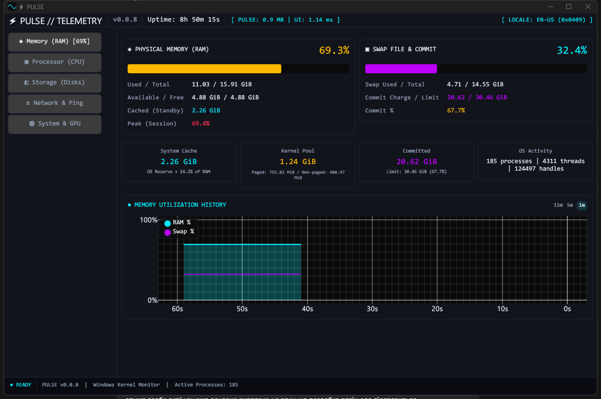

# ⚡ PULSE — Windows Memory & Process Telemetry HUD

A native Windows 10/11 task manager in Rust + `egui` that shows RAM composition, real-time per-process memory growth (`Δ RAM/s`), and which process caused a sudden memory spike.

**[📥 Download v0.1.0 Portable .exe (Windows 10/11 x64)](https://github.com/pete702/pulse-task-manager/releases/tag/v0.1.0)**

[](https://github.com/pete702/pulse-task-manager/actions)
[](LICENSE)
[](https://github.com/pete702/pulse-task-manager/releases)



## Why PULSE?

Standard Windows Task Manager shows total RAM usage, but rarely tells you **which process** caused a sudden memory jump or how much of your used memory is actually reclaimable OS Standby Cache.

PULSE provides a dark-mode telemetry HUD with a **Memory Spike Blackbox**, a **3-Segment RAMMap Composition Bar**, and a **Real-Time Leak Hunter (`Δ RAM/s`)**.

## Feature Status

| Subsystem / Feature | Status | Details |
| :--- | :--- | :--- |
| **Physical RAM & Swap/Pagefile** | **Implemented ✅** | Live usage bars, commit charge, and pressure verdicts |
| **Win32 Kernel Pool Telemetry** | **Implemented ✅** | Paged Pool, Non-Paged Pool, Standby Cache via `K32GetPerformanceInfo` |
| **3-Segment RAM Composition Bar** | **Implemented ✅** | Visual breakdown of `In Use`, `Standby Cache`, and `Free` RAM |
| **Virtualized Process Table** | **Implemented ✅** | `Ctrl+F` search, `Esc` clear, `[Nx]` clone grouping, `▲ HOG` badges |
| **Real-Time Leak Hunter (`Δ RAM/s`)** | **Implemented ✅** | Per-process working-set delta (`▲ +M/s` / `▼ -M/s`) updated at 1 Hz |
| **Memory Spike Blackbox & Chart** | **Implemented ✅** | Records culprit PID/process on RAM jumps; `1m/5m/15m` chart with 85% line |
| **1-Click Safe RAM Purge & Actions** | **Implemented ✅** | Non-blocking working-set trim (`K32EmptyWorkingSet`), PID Safety Gate, trim selected, end task, open file location, Before/After audit |
| **Processor (CPU) & EcoQoS** | *Planned (`v0.2.0`) 🔄* | Per-core grid, single-core bottleneck detector, Win32 EcoQoS toggle |
| **Storage & Disk I/O Freeze Hunter** | *Planned (`v0.3.0`) 🔄* | Volume capacity bars and per-process read/write MB/s table |
| **Network & Ping/Jitter Radar** | *Planned (`v0.4.0`) 🔄* | Adapter throughput and non-blocking TCP latency/jitter probe |
| **DXGI Multi-GPU & System Report** | *Planned (`v0.5.0`) 🔄* | Dedicated/Shared VRAM via `IDXGIAdapter3` and sanitized Markdown report |

## Technical Characteristics

- **Single Portable Executable**: Standalone `.exe` (`~4.0 MiB` binary size on disk), no installer, no background service.
- **Live Self-Diagnostics**: PULSE displays its own real-time memory working set and UI frame time directly in the top header badge (`[ PULSE: XX.X MB | UI: X.XX ms ]`).
- **Decoupled 1 Hz Collector**: Main `egui` UI thread + background telemetry worker thread (`bounded std::sync::mpsc::sync_channel(2)`) with 1 Hz process table row caching.
- **Minimize Hibernation**: UI rendering pauses while minimized and triggers a one-time working-set self-trim (`K32EmptyWorkingSet`); post-init frame #3 self-trim.
- **User-Mode Only**: Uses standard Win32 APIs (`K32GetPerformanceInfo`, `sysinfo`); no kernel drivers, no DLL injection, and no hooks into other processes.
- **PID Safety Gate**: Blocks PID 0, PID 4, self-PID, 21 critical OS processes, and 11 known anti-cheat processes before any mutating action.
- **Three Walls Badge**: Live `SYSTEM OPTIMAL` / `MEMORY WALL` / `COMPUTE WALL` / `I/O WALL` indicator in header.

## Keyboard Shortcuts

- `Ctrl + F` — Focus process search filter
- `Esc` — Clear search filter and reset focus

## Build from Source

Requires Rust `1.87+` on Windows 10/11 (x64 MSVC toolchain):

```powershell
git clone https://github.com/pete702/pulse-task-manager.git
cd pulse-task-manager
cargo run --release
```

## Documentation & License

For developers: [Architecture & Engineering Rules](ARCHITECTURE.md) · [Changelog](CHANGELOG.md)

Open-Source under the MIT License.